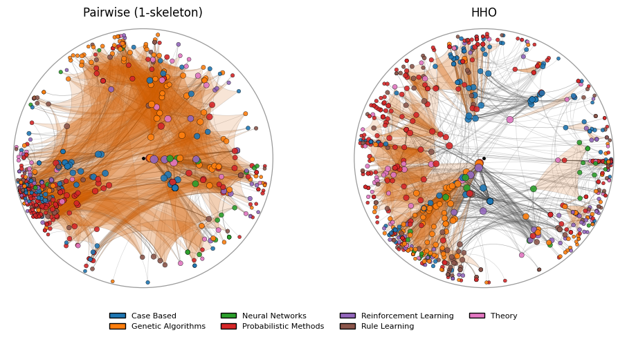

# HOHypEmb

[](https://doi.org/10.5281/zenodo.23695140)

Higher-order hyperbolic embedding (**HHO**) of simplicial complexes in the Poincaré disk.

HHO embeds a simplicial complex by adding a second layer with one point per filled triangle
(a larger simplex enters through its triangles), coupled to its vertices (strength μ) and to the
triangles sharing an edge with it (strength γ), and embedding the
two-layer network with the MLNHypEmb machinery. A node's radius is a fixed function of its
weighted degree in the (RA-preweighted, when `preweight=True`) pairwise graph, identical in the
classical and the HHO embedding: **HHO changes only angles**.



*The cora co-authorship network: authors colored by scientific field; shaded regions are articles with 3 to 6 authors. Classical embedding on the left, HHO on the right: under HHO each article is pulled together, while every author keeps its radius.*

## Install

HOHypEmb is a plain Python package (the `hohypemb/` folder) and works without installation. It needs
Python ≥ 3.9 and the usual scientific stack:

    pip install "numpy>=1.24" "scipy>=1.10" "scikit-learn>=1.3" "networkx>=3.0" "matplotlib>=3.7" "pandas>=2.0"

Then use it in any of three ways:

- **Copy the folder.** Put the `hohypemb/` folder next to your script or notebook (or anywhere on
  `sys.path`; the folder must keep the name `hohypemb`), then `import hohypemb as hh`. The folder carries its own `LICENSE` file; keep it with the code.
- **Clone the repository** and work from its root, or add the clone to your path:
  `import sys; sys.path.insert(0, "path/to/HOHypEmb")`.
- **Install it with pip:** `pip install git+https://github.com/MartinG-38/HOHypEmb`.

## Quickstart

```python
import hohypemb as hh
from hohypemb.datasets.synthetic import planted_surfaces

sc = planted_surfaces("holme_kim", p_surface=50)            # graph + filled triangles
params = hh.presets.EMBEDDING_PARAMS["synthetic_holme_kim"]
classical = hh.ClassicalEmbedder(**params).fit(sc, seed=0)
hho = hh.HHOEmbedder(mu=15, gamma=0.5, **params).fit(sc, seed=0)

print(hh.markers.area_ratio(sc, classical, hho).to_dict())
hh.plotting.plot_comparison(sc, classical, hho)
```

Your own data: `hh.SimplicialComplex.from_graph(G, simplices)` with a networkx graph `G` and the
filled simplices (each must be a clique of `G`); `examples/01_quickstart_synthetic.ipynb` shows how.

## Examples

Four notebooks, from first steps to real data. They reproduce the main results of the paper.

| Notebook | What you learn |
|---|---|
| [`01_quickstart_synthetic`](examples/01_quickstart_synthetic.ipynb) | Build a complex from your own graph, embed it, compare the classical and HHO embeddings |
| [`02_cora`](examples/02_cora.ipynb) | Nodes with labels: predict fields (k-NN), recover co-authors, compare with graph distances, tune μ and γ |
| [`03_ecoli`](examples/03_ecoli.ipynb) | Groups of nodes: functional categories, markers, recovering complex partners, how much tighter each complex gets |
| [`04_synthetic_markers`](examples/04_synthetic_markers.ipynb) | The classical and HHO embeddings; the area markers on two random-graph models |

The dataset notebooks download their data on first use (or read `HOHYPEMB_SNAPSHOT_DIR`).
`python examples/build_examples.py --execute` regenerates all four.
Jupyter is not a core dependency: `pip install -e ".[dev]"` installs what `build_examples.py` needs
(or open the notebooks in Jupyter). The committed outputs were produced with the paper's data snapshot.

## Markers

`hohypemb.markers`: `area_ratio`, `surface_vs_empty_areas`, `edge_vs_nonedge_distances`,
`global_distortion`, `label_separation`, `partner_precision_at_k`, `group_compactness`,
`triangle_clustering`. Each returns a dataclass with `to_dict()`.

## Datasets and licenses

| Dataset | Source | License | Citation |
|---|---|---|---|
| E. coli interactions | STRING v12.0, TaxID 511145 | CC BY 4.0 | Szklarczyk et al. (2023), doi:10.1093/nar/gkac1000 |
| E. coli complexes | EMBL-EBI Complex Portal, TaxID 83333 | CC BY 4.0 | Meldal et al. (2019), doi:10.1093/nar/gky1001 |
| COG categories (optional) | NCBI COG 2020 | US-government public resource | Galperin et al. (2021), doi:10.1093/nar/gkaa1018 |
| cora co-authorship | AHORN revision 2, Zenodo record 19232933 (doi:10.5281/zenodo.19232933) | "Unknown" on AHORN: downloaded, not redistributed | Frantzen & Schaub (2026), AHORN, arXiv:2608.03491; AHORN's converter script attributes the original dataset to "hypergraph learning benchmarks (DHGNN, HyperGCN, etc.)", without a more specific citation |

Files are cached in `~/.cache/hohypemb` (or `$HOHYPEMB_DATA`, or `data_dir=`), with a SHA-256 check
against the versions used in the paper. The Complex Portal file is a moving `current` release: to
reproduce the paper's E. coli numbers exactly, use the snapshot of the files used for the paper
(its SHA-256 are in `hohypemb/datasets/reference.py`). Depositing that snapshot on Zenodo is
recommended (CC BY 4.0 permits redistribution with attribution).

## Tests

    pip install -e ".[dev]"
    pytest                    # offline; `pytest -m network` for downloads

## Citation

Software DOI (all versions): [10.5281/zenodo.23695140](https://doi.org/10.5281/zenodo.23695140); see `CITATION.cff`.
HOHypEmb builds on MLNHypEmb (doi:10.5281/zenodo.15535819, arXiv:2505.20378).

## License

BSD-3-Clause.
